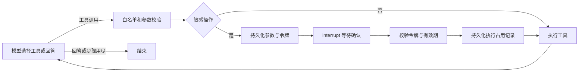

# Agent 增强实现与验收

本次实现不引入 Java 服务。Java/Python 联调以及原计划中依赖 Java 业务事务的 Outbox/RocketMQ 链路未纳入本次实现。退款沿用仓库原有模拟工具，不涉及真实资金。

## 启动

依赖已经安装到本项目 `.venv`。新环境先执行 `python -m pip install -r requirements.txt`。

在项目目录运行：

```powershell
# 本地 SQLite 演示，不依赖 PostgreSQL / Redis；不修改你的 .env 密钥。
$env:DB_ENABLED='false'
$env:REDIS_ENABLED='false'
.\.venv\Scripts\python.exe scripts/serve.py
```

打开 `http://127.0.0.1:8000/demo`，填写 `.env` 中 `API_TOKENS` 对应用户的令牌。令牌只存在页面内存，不保存在浏览器本地存储。若没有配置，按 `.env.example` 配置后重启，接口默认拒绝匿名访问。

`scripts/serve.py` 默认开启 `WORKFLOW_ENABLED=true` 和 `RAG_RETRIEVAL_MODE=hybrid`；显式环境变量可以覆盖。原 `main.py` 和直接启动 uvicorn 的入口仍尊重配置，默认保留旧模式，避免悄悄改变原调用方行为。新 CLI 模式支持 `status`、`approve`、`reject`、`recover`。

## 可恢复工作流

实现位于 `app/agent/workflow.py`，使用真实 LangGraph，而非重新命名原循环：



- State 保存模型消息、工具列表、当前下标、步数、待确认参数、单次令牌、到期时间、拒绝订单和工具结果。
- checkpoint 默认 SQLite，可配置 PostgreSQL saver。线程标识由用户和会话路径生成，HTTP 身份取自 Bearer 令牌。
- 敏感工具在生成审批前复用本地 Pydantic 参数校验；执行时再次校验。MCP 仍只有已有的 JSON 对象解析，不能声称已有远程工具完整 Schema 校验。
- `interrupt` 恢复会重跑所在节点，所以副作用前使用独立 SQLite 执行账本。当前整单模拟退款以“用户 + 工具 + 订单”为业务键，同一用户换会话或改原因也不会重新执行同一笔退款。
- 账本先占用后执行。崩溃或超时导致无法确认结果时，保守返回 `execution_unknown`，不自动重发。它不是与外部支付同库的事务，不承诺恰好一次；未知结果需人工核实，也不会因为删除聊天而清空执行账本。
- 冷启动即使还没有保存会话 JSON，也能根据 checkpoint 找回等待确认状态。已完成的消息仍保存到原存储层，记忆功能保留。
- 原生语义的审批授权只接受按钮/API（CLI 用 approve/reject）。普通聊天中的“确认”不会绕过待审批状态。

HTTP 新增：

| 接口 | 用途 |
| --- | --- |
| `GET /api/workflows/{session_id}` | 找回待确认参数、查看可恢复状态和上次工具结果 |
| `POST /api/workflows/{session_id}/recover` | 从故障 checkpoint 继续；待人工确认时不会替用户批准 |
| `POST /api/confirm` | 延续原接口，额外返回 reply、下一项 pending 和 request_id |
| `GET /api/traces/{request_id}` | 查询当前用户自己的请求追踪，其他用户得到 404 |

部署仍限定**单主机、单 worker**。PostgreSQL checkpoint 不会自动提供跨 worker 会话互斥，也不会把本地执行账本变成分布式事务。

PostgreSQL 配置：`WORKFLOW_BACKEND=postgres`，可用 `WORKFLOW_POSTGRES_URL` 指定 psycopg URI，留空则转换现有 DATABASE_URL。首次调用运行 saver.setup 创建所需表，数据库用户需有建表权限。Windows 请使用 `scripts/serve.py`，其 SelectorEventLoop 兼容 psycopg。**本次实际验证的是 SQLite；当前 Docker 引擎未运行，PostgreSQL saver 与 pgvector 新增全量读取接口未做数据库联调。**

## 中文混合检索

- 同一套 jieba 分词用于文档和查询，保留英文数字标识，构建 BM25。
- 向量和 BM25 各自召回，RRF 仅按排名融合，默认 k=60，候选上限 20；随后使用已有 BGE cross-encoder 取 top-3。
- `RAG_RETRIEVAL_MODE=vector / hybrid / legacy` 用于切换。legacy 保留原 pgvector 的全文优先策略，不能把它称为本次中文 BM25。
- 三个后端新增 all_chunks 接口，BM25 是进程内快照。知识库更新后需重建向量索引并重启服务/重置 retriever；不支持热更新的一致快照切换。
- 返回 doc_id、section、chunk_id、version；version 是片段内容 SHA-256 截断值，不是业务政策生效日期。归档旧文档放在 knowledge/archive 子目录，不参与当前顶层 Markdown 索引；不自动判断新旧规则是否冲突。
- 超长无分段正文也会拆分，避免单段突破正文长度预算。重排失败仍回退候选顺序。

## 固定题集与实验

`app/evaluation/retrieval_cases.json` 包含 **100 条 AI 编写、尚未人工审核**的题目：95 条有答案、5 条无答案。仅覆盖现有 4 份演示文档、19 个片段。按章节分组划分 dev/test，同章节的问题不跨集合；test 包含 70 条有答案与 5 条无答案。题集包含冻结正文、版本哈希、正确片段和分组。

三个真实 API 实验使用相同题目、知识库、嵌入模型和候选参数，结果在 `reports/retrieval-live.json`；词项离线基线在 `reports/retrieval-offline.json`。

| 方法 | 全部95题 Hit@1 | Hit@3 | MRR@3 | 排序阶段 P50 / P95 |
| --- | ---: | ---: | ---: | ---: |
| 向量 | 88.42% | 97.89% | 0.9263 | 1.05 / 10.72 ms |
| 向量 + BM25 + RRF | 94.74% | 100% | 0.9719 | 1.10 / 15.64 ms |
| 混合召回 + BGE | 97.89% | 100% | 0.9895 | 399.00 / 478.15 ms |

仅看留出集70题，三组 Hit@1 为 88.57%、97.14%、98.57%。100 次重排没有发生回退。延迟包含各自排序步骤及重排网络请求，**不包含共享批量 query embedding，也不是完整对话延迟**。批量 embedding 时间另存于 JSON；缓存命中时不伪造该时间。并发为 2，不是压力测试。

失败分析：

- rag-005 的第一名是“会员常见问题”，其文本同样说明按近12个月消费计算；当前金标仅标“等级体系”。这是需要人工复核的多正确片段问题。保留原报告，不在看完结果后修改标签抬高成绩。
- rag-060 询问“审核通过后的步骤”，重排把“特殊退款场景”放在通用退款流程前；正确片段仍在第二位。多场景时可要求回答先区分是否需要寄回，而非把单一路径推广给全部售后。

5 条无答案问题另用真实模型做基于证据的拒答组件评测，结果 5/5，见 `reports/abstention-live.json`。这里只检验结构化 answerable=false 且无引用，保留原回答供人工阅读；不代表整个 Agent 的路由/拒答率，也不是“相似度=正确概率”。

复现命令（后两项调用已配置的真实模型接口）：

```powershell
.\.venv\Scripts\python.exe scripts/eval_retrieval.py
.\.venv\Scripts\python.exe scripts/eval_retrieval.py --live --output reports/retrieval-live.json
.\.venv\Scripts\python.exe scripts/eval_abstention.py
.\.venv\Scripts\python.exe scripts/smoke_workflow_live.py
```

不要直接重建题集来消除知识库哈希不一致，应先审核知识库变更与金标。现有题集不算人工审核成果，也不因有100条就代表真实业务覆盖充分。

## 追踪与指标

沿用 request_id 并新增 span/parent_span，覆盖模型、检索嵌入、召回、重排、工具、工作流路由、人工等待和请求总时长。记录 Token、重试、参数校验失败和工具结果类别。模型 Token 成本依据配置的每百万单价估算；没有单价时标记 pricing_configured=false。Embedding Token 另计，未计入模型费用；不包含重排计费。

首个有效响应指“最终回答或确认卡片”产生的时间，不是 token 流的 TTFT。确认等待单独记录 wait_ms，和恢复请求处理时间分开。对外 `/api/confirm` 和聊天 SSE 都提供可查询的 request_id。

追踪只存元数据，不存 prompt、工具参数、完整输出和密钥。每个请求最多1000条事件，启动与每小时清理超过7天记录。SQLite 是本地调试查询，不是分布式观测平台；高并发情况下同步写入开销需要另做压测。

原评估器继续保留含 Token 预算的严格 pass_rate，额外给出 functional_pass_rate 和预算通过数量，避免把“超 Token 预算”解释成“回答错误”。

## 回归验收

运行 `python scripts/verify_upgrades.py`，报告在 `reports/upgrade-tests.json`。2026-10-19 当时 **55 项通过**（新增记忆回归见 [后续修复记录](memory-context-20261020.md) 与最新机器报告），包含真实 SQLite checkpoint、重建图/Agent、错误令牌/过期/拒绝、执行后模型故障恢复、并发占用、用户隔离、HTTP 恢复和追踪权限，以及已有工具治理、会话互斥、记忆维护回归。这里模型用测试替身，不冒充真实模型效果。

另运行原 `test_rerank.py`、`test_hitl.py`、`test_stability.py`：已执行检查通过；Redis Lua 实例测试因 Redis 不可用跳过。真实模型工作流结果单独保存于 `reports/workflow-live.json`，不能与故障注入测试混算成任务完成率。

可以写入简历的实现：LangGraph checkpoint/interrupt/resume、参数绑定审批、保守的持久化执行去重、中文 BM25/RRF/BGE 对照、带用户权限的请求追踪。指标引用必须说明演示知识库和待人工审核题集。暂不写“生产支付幂等”“多 worker 高可用”“人工审核100题”“PostgreSQL恢复已实测”。
